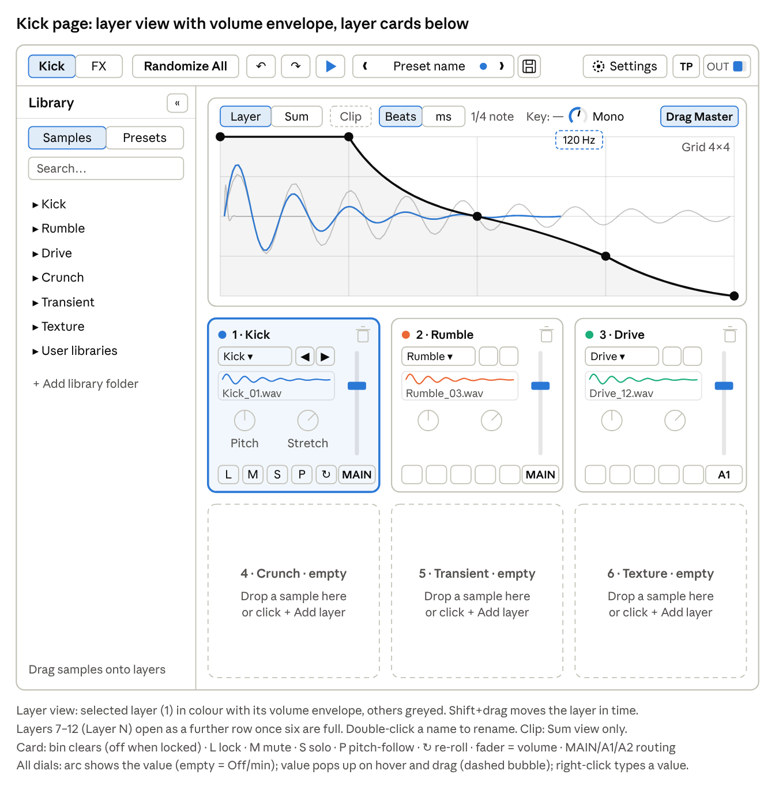
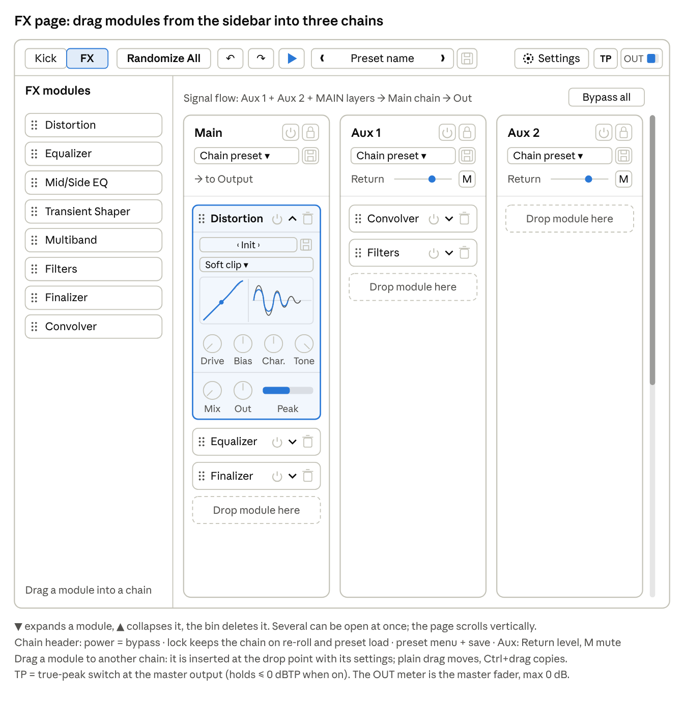
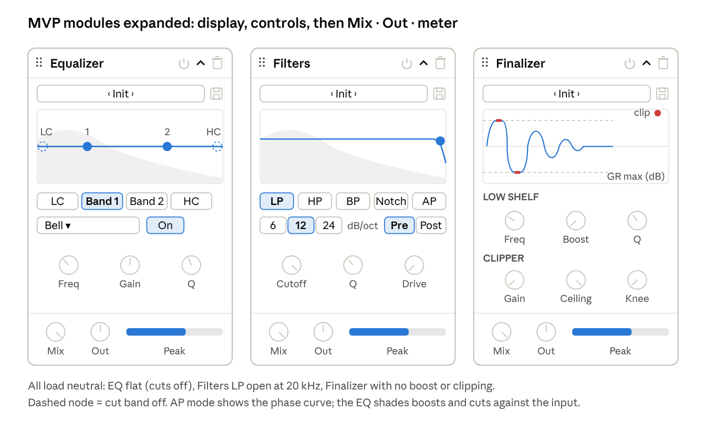
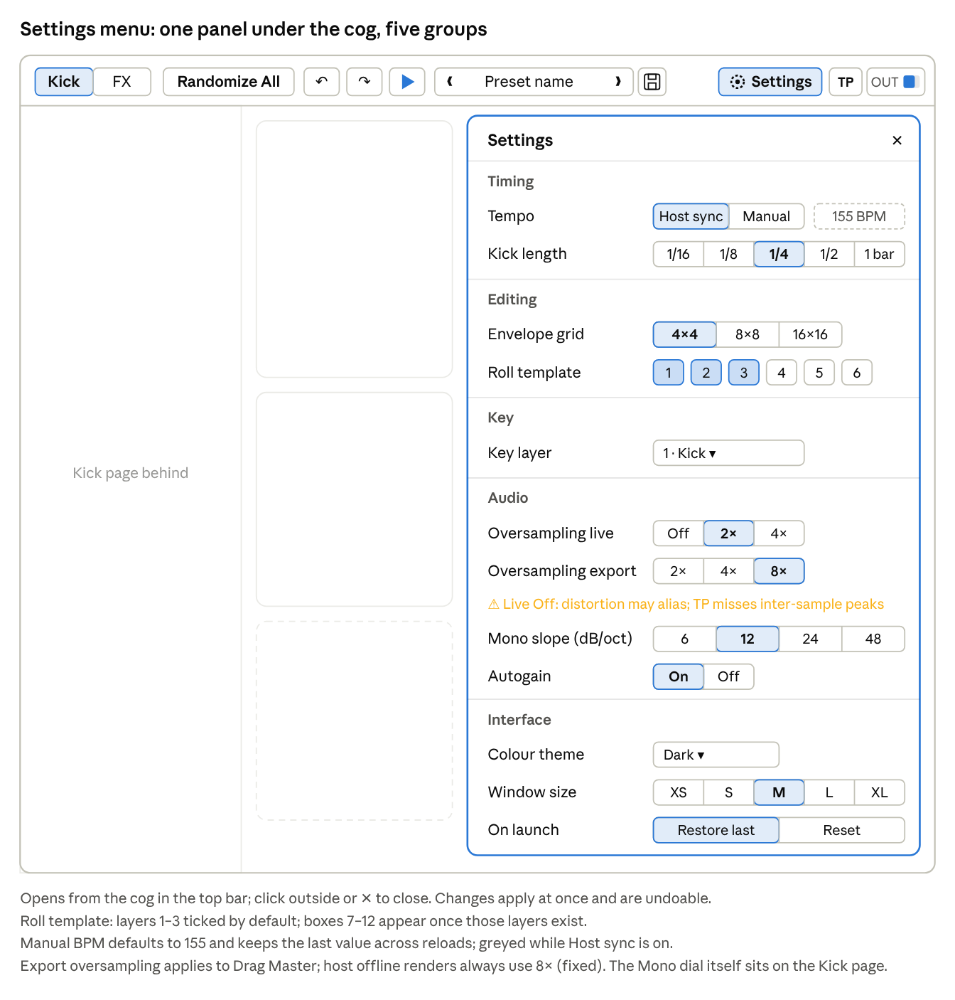
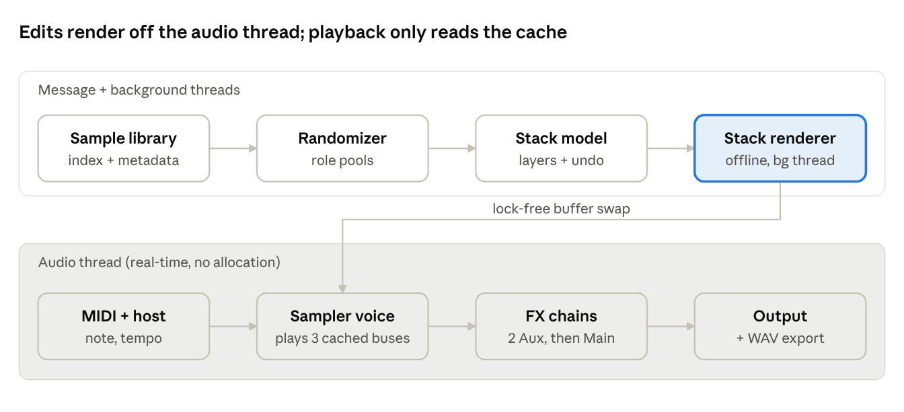

# KLAY — Requirements & Specification

Oct 19, 2026 · @Bernard

## 1. Document control & purpose

This is version 0.4 (draft) of the requirements and specification for KLAY (working title), a layer-based kick drum plugin inspired by a commercial layer-based kick plugin. Its job is to give the coding session a single, testable source of truth.

- **Scope:** a VST3 instrument plugin for Windows that stacks sample layers into a kick, processes it through a modular FX rack, and exports the result. Version 1 is a pure sample player with no genre style targets.
- **Out of scope (v1):** synthesis (planned for version 2), genre style targets, macOS / AU / AAX, standalone app, copy protection and licensing, distribution, stem export (version 2), sequencing.
- **Requirement IDs:** `FR-xxx` functional, `NFR-xxx` non-functional, `UI-xxx` interface, `C-xxx` constraint. Priority uses MoSCoW (Must / Should / Could / Won't).

## 2. Product vision & goals

A producer should get from an empty layer to a club-ready, in-key techno kick in under 60 seconds, then refine every layer without leaving the plugin.

**Goals**

1. **Speed:** role-based randomization (no genre rules) produces usable kicks on most rolls.
2. **Control:** per-layer timing, a drawable volume envelope, pitch and stretch, plus three kick-focused FX chains.
3. **Openness:** users load their own samples and libraries alongside the factory content.
4. **Integration:** follows DAW tempo and MIDI pitch; exports the master by drag and drop (stems in version 2).

**Non-goals (v1):** genre style targets, competing on library size, general-purpose drum synthesis, AI-generated audio.

**Version 2:** a synthesis engine for the main kick tail, layered with the sample parts.

**Difference from the reference:** no style targets — the user decides what goes into a kick, not a genre ruleset.

**Further ideas (undecided):** phase-alignment assistant between punch and tail, MIDI-velocity-driven layer morphing (kept for version 2; v1 ignores velocity, FR-001).

## 3. Reference product

KLAY is inspired by a commercial layer-based kick plugin. The detailed analysis of that product is kept in a separate private document, because this spec is published with the source code.

## 4. Users, personas & key use cases

The primary user is a techno or hard-dance producer working at 135–160+ BPM who needs a distinctive kick fast and wants to tweak it, not build it from scratch.

| Persona | Need | Success looks like |
| --- | --- | --- |
| Hobbyist producer | A pro-sounding kick without deep sound-design skills | Usable kick from a single roll; factory presets |
| Working producer / DJ | Speed and a signature sound across tracks | Own samples in the randomizer; saved FX chains; parallel aux processing |
| Sound designer | Fine control and clean exports | Sample-accurate alignment, phase-safe layering, 24-bit export |

**Key use cases**

1. **UC-1 Roll a kick:** press Randomize All, audition via MIDI or the play button, repeat or undo.
2. **UC-2 Refine a layer:** select a layer, swap its part, lock the rest, adjust offset, volume envelope, pitch and fader level.
3. **UC-3 Play in key:** key detection on layer 1 (Kick) sets the root; MIDI notes transpose all pitch-following layers in real time.
4. **UC-4 Process:** build the Main and two Aux chains from the module sidebar, route layers to an aux chain, tweak modules, lock chains while re-rolling layers.
5. **UC-5 Bring own sounds:** drag a folder in; it becomes a library usable in pickers and rolls.
6. **UC-6 Export:** drag the master (incl. all FX chains) into the DAW timeline as WAV.
7. **UC-7 Recall:** project reopens with identical sound (state saved in the host session).

## 5. Glossary

| Term | Meaning in this document |
| --- | --- |
| Part | One audio sample loaded into a layer |
| Layer | A position in the stack (6 default, 12 max) holding one part; default names Kick, Rumble, Drive, Crunch, Transient, Texture, then Layer 7–12, renamable by double-click, with its own offset, volume envelope, fader, pitch, stretch, role and routing |
| Kick (layer 1) | The main kick body; carries the fundamental and is the key layer by default |
| Crunch (layer 4) | Distorted, pitched low-end tail that follows the punch |
| Rumble (layer 2) | Reverberated, filtered low-end bed after the kick (typical in hard techno) |
| Transient (layer 5) | Short high-frequency attack layer for definition |
| Drive (layer 3) / Texture (layer 6) | Drive: saturated layer adding density; Texture: extra noise, tops or reverb layer |
| Role | The kind of part a layer holds (Kick, Rumble, Drive, Crunch, Transient, Texture or Any); layers 1–6 default to the role of their name; rolls draw from that role's pool |
| Roll | One randomization action producing a new kick |
| FX chain | Ordered list of FX modules with settings, saveable as a preset; there are three: Main, Aux 1, Aux 2 |
| Render | Offline bounce of the stack (and, for export, all three FX chains) to an audio buffer |
| Key Track | Mode where incoming MIDI notes transpose pitch-following parts |
| Aux chain / routing | One of two parallel FX chains; a layer is routed to it all or nothing, and its output is mixed with the Main-routed layers before the Main chain |
| Volume envelope | Drawable gain curve per layer over the kick length, snapped to a grid; replaces fades and sidechain ducking |
| Selected layer | The layer whose card was clicked last (layer 1 by default); the visualiser shows it in colour and edits its envelope |
| Key layer | The layer whose key is detected and used for Key Track (layer 1 by default, changeable in Settings) |
| Mono (elliptical filter) | Mastering-style filter that high-passes only the side signal, making everything below the cutoff mono |
| TP (true peak) | Peak level including peaks between samples (dBTP); the TP switch at the master output holds it at or below 0 dBTP (FR-218) |

## 6. Platform & integration requirements

Version 1 targets one format on one platform: VST3 on Windows 10+ x64. The core stays platform-neutral so a macOS / AU port remains possible later. Plugin identity: shown in hosts as Klaymore by MINDBEND AD (manufacturer code KLAY, plugin code klay, bundle ID com.01.klay); KLAY stays the project's working title.

| ID | Requirement | Priority |
| --- | --- | --- |
| C-001 | Build as a VST3 instrument plugin for Windows | Must |
| C-002 | Windows 10+ x64 | Must |
| C-003 | macOS / AU and a standalone app | Won't (v1) |
| C-004 | AAX / Pro Tools support | Won't (v1) |
| C-005 | CLAP format | Could |
| FR-001 | Accept MIDI note-on to trigger the kick; velocity is ignored (every hit plays at full level) | Must |
| FR-002 | Read host tempo and transport; manual BPM override, default 155 BPM; a changed value persists across reloads until changed again | Must |
| FR-003 | Save and restore full state (stack, routing, volume envelopes, all three FX chains, settings, user sample references) via host session | Must |
| FR-004 | Output stereo; the Mono dial on the Kick page (FR-216) makes the low end mono. A duplicate on the Finalizer follows in version 2 for per-layer export | Must |
| FR-005 | Support sample rates 44.1–192 kHz and buffer sizes 16–4096 | Must |
| FR-006 | Expose only real-time parameters for host automation. MVP: master gain, aux return levels, aux mutes, Mono and TP. FX module parameters follow in M6 through a fixed set of automation slots, since modules are added and removed at runtime. Layer parameters baked into the offline render (fader, pitch, stretch, envelope) are not automatable | Should |
| FR-007 | Validate in Windows VST3 hosts: Ableton Live, FL Studio, Bitwig, Reaper, Cubase, Studio One. M0 and the MVP smoke tests use Ableton Live, Reaper and FL Studio; the others follow when available | Must |
| C-006 | Every file, module or third-party dependency under a GPL-family licence (GPL, LGPL, AGPL, incl. JUCE) is labelled so it can be found and replaced for a commercial release: an SPDX header (e.g. SPDX-License-Identifier: AGPL-3.0-only), a searchable marker comment LICENSE-GPL, and an entry in THIRD\_PARTY\_LICENSES.md (component, licence, files, replacement option). A CI check fails if a GPL-family file lacks the marker. | Must |
| C-007 | Keep direct JUCE API use in clearly named layers (plugin/, ui/, adapters) so the DSP and model core stays JUCE-free where practical, limiting what must change for a commercial licence switch | Should |

## 7. Functional requirements

Requirements are grouped by subsystem; each maps to a module in section 10.

### 7.1 Layer engine (stack)

| ID | Requirement | Priority |
| --- | --- | --- |
| FR-100 | Stack of N layers, default 6, expandable to 12 | Must |
| FR-101 | Per layer: sample, volume fader (−∞ to 0 dB, default 0 dB; top-weighted travel, so the upper range of about −12 to 0 dB gets most of the fader travel), lock | Must |
| FR-102 | Per layer: time offset (sample-accurate, Shift+drag on the waveform), start trim and end trim (handles at the left and right edges of the waveform in Layer view) | Must |
| FR-103 | Per layer: drawable volume envelope (section 7.8); replaces separate fades | Must |
| FR-104 | Per layer: pitch ±12 semitones and ±100 cents, length-preserving (Signalsmith Stretch) | Must |
| FR-105 | **Per layer: length change without pitch change**, 0.25×–8×, using Signalsmith Stretch — top priority of the pitch/length features | Must |
| FR-106 | Per layer mode, default Stretch. Stretch (Signalsmith): the Pitch knob changes pitch without changing length, the Stretch knob changes length without changing pitch. Repitch (varispeed): the Pitch knob is greyed out and the Stretch knob sets the playback speed, so pitch and length change together | Must |
| FR-107 | Stack is rendered offline whenever a layer edit occurs, into three cached buses (Main-routed, Aux 1, Aux 2), each split into pitch-following and fixed layers for real-time Key Track (FR-125); playback reads the cache | Must |
| FR-108 | Kick length set in Settings as a note value: 1/16, 1/8, 1/4 (default), 1/2, 1 bar; converted to ms from host BPM; defines visualiser, render and export length, with a 5 ms soft fade at the end. Envelope points keep their absolute time when the length changes | Must |
| FR-109 | Autogain (on/off in Settings, default On): one gain, computed from the summed pre-FX buses (Main, Aux 1, Aux 2) and applied equally to all of them, normalises the rendered stack to a target peak (default −0.3 dBFS) before the FX chains | Should |
| FR-110 | Mute per layer; several layers can be muted at once; Shift+click on any Mute unmutes all layers when at least one is muted | Must |
| FR-111 | Solo per layer is exclusive: a new Solo replaces the previous one; Shift+click adds further Solos; Mute beats Solo | Must |
| FR-112 | Bin icon clears the layer to empty; disabled while the layer is locked; undoable | Must |
| FR-113 | Clicking a layer card selects it; layer 1 is selected by default | Must |
| FR-114 | Default layer names: 1 Kick, 2 Rumble, 3 Drive, 4 Crunch, 5 Transient, 6 Texture, 7–12 "Layer N"; double-click renames any layer. Layer 1 (Kick) is the key layer | Must |
| FR-115 | Monophonic playback: a new note-on cuts the ringing kick with a 5 ms fade | Must |
| FR-116 | Audition button in the top bar (and space bar) plays the kick | Must |

**Listening test LT-1 — length change (run in M1, before stretch settings are locked)**

1. **Material:** 10–15 factory parts covering punches, crunches/tails, transients and rumbles.
2. **Processing:** stretch each part to 0.5×, 0.75×, 1.5×, 2× and 4× length with Signalsmith Stretch (default and cheaper presets); unprocessed and Repitch versions as references.
3. **Listen for:** transient smearing on punches, phasiness or metallic artefacts in tails, pre-echo, low-end loss, level change.
4. **Method:** level-matched blind A/B on monitors and headphones, then inside a full stacked kick.
5. **Pass:** no audible transient smear on punches between 0.75× and 1.5×; tails usable between 0.5× and 2×.
6. **Record:** results, chosen preset and parameters go in the decision log. If punches fail, default punch layers to Repitch and evaluate Bungee as fallback.

### 7.2 Pitch & key

| ID | Requirement | Priority |
| --- | --- | --- |
| FR-120 | Detect the fundamental/key of the key layer (layer 1, Kick, by default) with an own YIN implementation (30–150 Hz search, median over the settled tail), FFT peak as cross-check; flag the key as uncertain when they disagree; store in metadata | Must |
| FR-121 | Key Track mode: a MIDI note transposes all pitch-following layers relative to the key layer's detected root, in real time (FR-125). There is no global switch: Key Track acts on every layer with pitch-follow on; the note equal to the root plays untransposed; with no detected key, follow layers play untransposed and the key display shows “—” | Must |
| FR-122 | Per-layer pitch-follow toggle; off by default on every layer, including the key layer | Must |
| FR-123 | Key display in the UI (note name + Hz) | Should |
| FR-124 | Key layer selectable in Settings (default layer 1), e.g. when layer 1 has no detectable key | Should |
| FR-125 | Real-time transposition for Key Track over the full MIDI note range (0–127): no audible delay at note-on; implementation see chapter 10 | Must |

### 7.3 Randomization (role-based, no style targets)

| ID | Requirement | Priority |
| --- | --- | --- |
| FR-140 | Each layer has a role (Kick, Rumble, Drive, Crunch, Transient, Texture or Any); layers 1–6 default to the role of their name; rolls draw only from that role's pool | Must |
| FR-141 | Randomize All: draw a new sample for each unlocked layer in the roll template (FR-146) from its role pool; all other layers stay as they are, or empty. Only samples are replaced — fader, envelope, offset, pitch, stretch, routing and FX stay | Must |
| FR-142 | Randomize one layer from its role's pool; as FR-141, only the sample is replaced | Must |
| FR-143 | Locked layers are never changed by rolls; mute/solo persist | Must |
| FR-144 | Dropped (Chaos option no longer required) | — |
| FR-145 | Undo/redo of all edits — layers, envelopes, routing, FX chains and settings (≥ 50 steps); Ctrl+Z / Ctrl+Shift+Z | Must |
| FR-146 | Roll template: user-editable set of layers (in Settings) that Randomize All re-rolls (default: layers 1–3, Kick, Rumble, Drive) | Should |
| FR-147 | Seeded RNG so a roll can be reproduced from its seed (debugging and preset sharing) | Should |
| FR-148 | Option to restrict rolls to selected library folders (factory or user) | Could |

### 7.4 Sample library

| ID | Requirement | Priority |
| --- | --- | --- |
| FR-160 | Factory library (provided by the product owner) organised as Role → sub-folder → files (roles: Kick, Rumble, Drive, Crunch, Transient, Texture) | Must |
| FR-161 | Import WAV, AIFF, FLAC; OGG and MP3 optional | Must / Could |
| FR-162 | Drag an audio file onto a layer to load it | Must |
| FR-163 | Add a user library by dragging a folder (≤ 4 levels); audio copied into the app's data folder | Should |
| FR-164 | User libraries appear in pickers and can be included in randomization | Should |
| FR-165 | Sample index with metadata (role, folder, root note, length, peak) built at import, cached on disk | Must |
| FR-166 | Browser filters by role and folder; search by file name | Could |

### 7.5 FX rack

| ID | Requirement | Priority |
| --- | --- | --- |
| FR-200 | Three FX chains: Main (on the master output), Aux 1 and Aux 2 | Must |
| FR-201 | Chains are built by drag & drop of modules from the FX module sidebar; modules can be reordered by drag, duplicated, bypassed and deleted (bin icon) | Must |
| FR-202 | The same module type may appear several times in a chain; no fixed module limit per chain | Must |
| FR-203 | Per layer: routing to exactly one destination — MAIN (default), A1 or A2; all or nothing, no send levels | Must |
| FR-204 | Signal flow: Main-routed layers + Aux 1 output + Aux 2 output → Main chain → output | Must |
| FR-205 | Per aux chain: return level and mute | Must |
| FR-206 | Global FX bypass and per-chain bypass | Must |
| FR-207 | Every module: dry/wet mix, output trim, output meter | Must |
| FR-208 | FX chain presets saved per chain; any saved chain loads into Main, Aux 1 or Aux 2; Lock per chain persists across rolls and kick preset loads | Must |
| FR-209 | Per-module factory presets | Should |
| FR-210 | All chains processed in real time on playback; Drag Master renders offline through all three chains | Must |
| FR-211 | A module dragged from one chain into another is inserted at the drop position with its current settings, not defaults; a plain drag moves it, Ctrl+drag copies it | Must |
| FR-212 | Global oversampling with two settings: Live (Off / 2× / 4×, default 2×) for playback, Export (2× / 4× / 8×, default 8×) for Drag Master. Host-driven offline renders (bounce, freeze) always use 8×, not editable; documented in the user manual (chapter 15) | Must |
| FR-213 | Oversampling is applied only inside modules that create harmonics (Distortion, Filters Drive, Finalizer clipper, any other saturating stage); linear modules run at the host rate; no per-module oversampling control in v1 | Must |
| FR-214 | Internal delay compensation: Main-routed layers, Aux 1 and Aux 2 are time-aligned before they are summed into the Main chain; total latency is reported to the host | Must |
| FR-215 | Equalizer, Mid/Side EQ and Filters use matched ("de-cramped") biquad designs after Vicanek (2016), so bell, shelf and cut shapes stay correct up to Nyquist without oversampling | Must |
| FR-216 | Mono dial: elliptical filter on the master output after the Main chain — the side signal is high-passed at the cutoff, so everything below is mono and the mid is untouched. Cutoff 0 (off, no processing) to 500 Hz, default 120 Hz; filter slope set in Settings; included in Drag Master | Must |
| FR-217 | Master fader (top bar output meter): −∞ to 0 dB maximum, default 0 dB; no positive gain at the master output | Must |
| FR-218 | TP (true-peak) switch next to the master meter, default Off. On: a true-peak clipper as the very last stage (after the Mono dial and master fader) holds the output at or below 0 dBTP, measured at the global oversampling factor (Live for playback, Export for Drag Master, 8× for host offline renders; FR-212). With Live set to Off, TP limits sample peaks only during playback; the Live Off warning says so (UI-017); its latency is reported to the host; the meter reads dBTP. Included in Drag Master. True-peak handling lives here only, not in the Finalizer | Must |

Module backlog in build order (MVP set in bold):

| Module | v1 scope |
| --- | --- |
| **Distortion** | Ten modes incl. Tape, Tube and three Amp modes; drive, bias, character, tone (7.5.2); oversampling from the global setting (FR-212) |
| **Equalizer** | 4 bands: low cut, two parametric bands, high cut (7.5.3); note-name frequency entry; matched biquads (FR-215) |
| **Finalizer** | Low-shelf boost, clipper with clip indicator; mono-below option added in version 2 (the global option covers v1) |
| **Filters** | LP/HP/BP/notch/all-pass with selectable slopes and a filter drive (7.5.4), matched biquads (FR-215); comb and phaser later |
| Transient Shaper | Attack amount, sustain, speed |
| Mid/Side EQ | Low-cut on side, simple bands on mid |
| Multiband | 3-band up/down compression, crossovers, per-band gain |
| Convolver | IR loader, tempo-synced envelope on the wet signal |

The reference's Kick Shaper module is dropped: the per-layer volume envelope covers it, and also replaces sidechain ducking.

### 7.5.1 Common module rules

Every FX module follows these rules; module-specific specs only add to them.

| ID | Rule | Priority |
| --- | --- | --- |
| FR-220 | Header row: drag handle · name · power (bypass) · ▼/▲ · bin; a collapsed module shows only this row | Must |
| FR-221 | Expanded layout: display (curve, spectrum or meter) on top, module controls in the middle, bottom row with Mix, Out and the meters | Must |
| FR-222 | Preset row: preset field with ‹ › arrows and a save icon; factory presets first, then user presets | Must |
| FR-223 | Module width is fixed to the chain column; modules grow downwards only | Must |
| FR-224 | A newly added module loads its first factory preset, "Init", which is the module's default state (each module ships at least this one) | Must |
| FR-225 | Bypass crossfades over about 10 ms; a bypassed module keeps its latency so timing does not shift | Must |
| FR-226 | Every parameter is smoothed (about 20 ms), including host automation | Must |
| FR-227 | Mix 0% fully bypasses the effect, latency kept | Must |
| FR-228 | Out −12 to +12 dB, default 0 dB; no automatic gain compensation | Must |
| FR-229 | Drive control (input gain) on the Distortion module only: 0 to +36 dB, default 0 dB; no separate Input control (7.5.2) | Must |
| FR-230 | Every module has a peak output meter; dynamics modules (Multiband, Transient Shaper) also show gain reduction | Must |
| FR-231 | Stereo linked processing; mid/side only in modules built for it (Mid/Side EQ) | Must |
| FR-232 | One interface for all modules: prepare (sample rate, block size), process, reset, latency, state save/load, parameter list | Must |
| FR-233 | Each module reports its latency, including oversampling; the chain sums and compensates it (FR-214) | Must |
| FR-234 | Real-time safe processing: no memory allocation or locking (NFR-001) | Must |
| FR-235 | Parameter IDs never change once released; module state carries a version number (NFR-012) | Must |
| FR-236 | Clean start per note without clicks: the FX chains run as two alternating instances. On note-on the new kick goes into a freshly reset instance while the previous instance's output fades out over 5 ms (FR-115) and is then reset. On transport stop the output fades out over 5 ms before reset | Must |
| FR-237 | CPU budget: no single MVP module above 1% of a core at 48 kHz with Live 2× (to confirm in M4) | Should |
| FR-238 | Displays and meters update at about 30 fps from data passed lock-free from the audio thread | Should |
| FR-239 | One completed control gesture (mouse down to mouse up) is one undo step | Must |

*Detailed specs of the four MVP modules follow in 7.5.2–7.5.5.*

### 7.5.2 Distortion

Distortion is a single waveshaping stage with ten curve types, Drive, Bias and one mode-dependent Character control. Only the shaper runs oversampled (FR-213); everything around it runs at the host rate.

**Signal path**

1. Drive: the only input gain of this module (FR-229)
2. Bias: DC offset added before the shaper
3. Shaper, oversampled at the global rate (FR-212)
4. DC blocker
5. Tone: post low-pass
6. Mix (dry is latency-matched), then Out (FR-207, FR-228)

**Parameters**

| Parameter | Range | Default | Notes |
| --- | --- | --- | --- |
| Mode | Soft clip · Hard clip · Tanh · Wavefold · Rectify · Tape · Tube · Amp High-gain · Amp Bass · Amp Crunch | Soft clip | Switch crossfades over 10 ms |
| Drive | 0 to +36 dB | 0 dB | Input gain into the shaper (no separate Input control); 0 dBFS = shaper threshold 1.0 |
| Bias | −100 to +100 % | 0 % | Offset of ±0.5 before the shaper; adds even harmonics |
| Character | 0 to 100 % | per mode | Meaning depends on mode (next table) |
| Tone | 1 to 20 kHz | 20 kHz | 1-pole low-pass after the shaper; 20 kHz = off |
| Mix | 0 to 100 % | 0 % | Common rule FR-227 |
| Out | −12 to +12 dB | 0 dB | Common rule FR-228, no auto gain |

**Curve types** (x = signal after Drive and Bias, c = Character 0–1)

| Mode | Transfer curve | Character controls | Default c |
| --- | --- | --- | --- |
| Soft clip | Linear up to the knee, cubic bend to ±1 | Knee width: 0 = hard corner, 1 = bend starts at 0 | 50 % |
| Hard clip | clamp(x, −1, +1) | Ceiling: −12 to 0 dB, output re-scaled to ±1 | 100 % |
| Tanh | tanh(k·x) / tanh(k), k = 1 + 4c | Saturation curvature | 25 % |
| Wavefold | sin(π/2 · x · (1 + 7c)) | Fold gain: 1 to 8 folds | 20 % |
| Rectify | (1 − c)·x + c·abs(x) | Blend clean → full-wave rectified | 50 % |
| Tape | x / (1 + abs(x)), followed by a high-frequency roll-off that deepens as Drive rises | Roll-off start: 20 kHz (c = 0) down to 6 kHz (c = 1) | 30 % |
| Tube | x ≥ 0: tanh(x); x < 0: tanh(a·x) / a with a = 1 − 0.8c, so the negative half clips later | Asymmetry: 0 = symmetric, 1 = strongly lopsided (more even harmonics) | 40 % |
| Amp High-gain | Low cut 100 Hz (1st order) and +6 dB bell at 800 Hz → stage 1 tanh → stage 2 Tube curve (a = 0.6). Thick, mid-forward, compressed | Preamp gain into stage 2: ×1 to ×20 | 60 % |
| Amp Bass | No low cut, +3 dB bell at 500 Hz → stage 1 tanh → stage 2 Soft clip. Keeps the low end, gritty mids | Preamp gain into stage 2: ×1 to ×10 | 40 % |
| Amp Crunch | Low cut 60 Hz (1st order), flat mids → stage 1 Tube curve (a = 0.7) → stage 2 Soft clip. Lighter, open breakup | Preamp gain into stage 2: ×1 to ×5 | 30 % |

**Requirements**

| ID | Requirement | Priority |
| --- | --- | --- |
| FR-300 | Ten modes as in the table above; a mode change crossfades old and new curve over 10 ms | Must |
| FR-301 | Shaper oversampled with JUCE dsp::Oversampling: minimum-phase IIR half-band filters for Live, linear-phase FIR for Export; latency reported per FR-233 | Must |
| FR-302 | DC blocker after the shaper: 1st-order high-pass at 5 Hz, so Bias and Rectify never leave DC in the output | Must |
| FR-303 | Display: transfer curve (input level vs output) with the current peak marked as a moving dot; under it, input and output waveform of the last hit | Must |
| FR-304 | Gain staging: with Drive 0 dB and Bias 0 %, a −6 dBFS sine passes Soft clip and Tanh with under 1 % THD | Should |
| FR-305 | Tone control | Must |
| FR-306 | Factory presets: at least one per mode (FR-224); "Init" preset (loaded on insert) = Soft clip, Drive 0 dB, Mix 0 %, other parameters at defaults; preset names follow later | Should |
| FR-307 | Drawable asymmetric waveshaper (from the reference plugin) | Won't (v1) |
| FR-308 | Full magnetic hysteresis tape model (e.g. ChowTape, GPLv3 — label per licensing policy) in place of the static Tape curve | Won't (v1) |
| FR-309 | Amp modes: pre-filter at host rate → stage 1 → stage 2, both stages oversampled; Drive feeds stage 1, Character sets the gain between the stages; three separate modes, no blending between them; no cabinet simulation; Tone acts as the amp's tone control | Must |

**Open points**

- [x] Tone stays in v1 (decided 2026-10-18).
- [x] Drive range 0 to +36 dB, default 0 dB, merged with Input (decided 2026-10-18).
- [ ] Factory preset names and count — content from you, as with the samples.

### 7.5.3 Equalizer

The Equalizer has four bands in fixed order: low cut, two fully parametric bands, high cut. It loads flat: both cuts off, both bands at 0 dB. All filters are matched biquads (FR-215), run at the host rate and add no latency.

**Bands**

| Band | Types | Frequency | Gain | Q | Default |
| --- | --- | --- | --- | --- | --- |
| Low cut | High-pass, 6 · 12 · 24 dB/oct | 20 Hz to 2 kHz | — | 0.5 to 10 | Off, 20 Hz, 12 dB/oct, Q 0.71 |
| Band 1 | Bell · Low shelf · High shelf · Notch | 20 Hz to 20 kHz | −18 to +18 dB | 0.1 to 18 | Bell, 100 Hz, 0 dB, Q 1.0 |
| Band 2 | Bell · Low shelf · High shelf · Notch | 20 Hz to 20 kHz | −18 to +18 dB | 0.1 to 18 | Bell, 2 kHz, 0 dB, Q 1.0 |
| High cut | Low-pass, 6 · 12 · 24 dB/oct | 200 Hz to 20 kHz | — | 0.5 to 10 | Off, 20 kHz, 12 dB/oct, Q 0.71 |

Q above 0.71 on a cut gives a resonant bump at the cutoff; below it, a softer knee. At 6 dB/oct there is no Q (the control is greyed out). Notch ignores Gain. Mix and Out follow the common rules (FR-227, FR-228); Mix defaults to 100 %.

**Requirements**

| ID | Requirement | Priority |
| --- | --- | --- |
| FR-310 | Four bands in fixed order (low cut, Band 1, Band 2, high cut), each with its own on/off switch | Must |
| FR-311 | Default state is flat: both cuts off, both bands Bell at 0 dB (the "Init" preset, FR-224) | Must |
| FR-312 | Display: combined response curve over a live spectrum of the module output (FR-238); the difference to the input spectrum is shaded — boosts in one colour, cuts in another (two FFTs, UI side only); one draggable node per band — drag sets frequency and gain, mouse wheel sets Q, double-click resets the band | Must |
| FR-313 | Frequency can be typed in Hz or as a note name C0–B9 (A4 = 440 Hz) | Should |
| FR-314 | Band type changes crossfade over 10 ms, so switching never clicks | Must |
| FR-315 | Matched biquad designs after Vicanek (FR-215); no oversampling, zero latency (FR-213) | Must |
| FR-316 | Slope switch per cut band: 6 dB/oct (1st order, no Q), 12 dB/oct (one 2nd-order section, Q on it), 24 dB/oct (two cascaded 2nd-order sections: first fixed at Q 0.71, Q on the second); slope changes crossfade over 10 ms | Must |

**Open points**

- [x] Cut slopes: 6 / 12 / 24 dB/oct switch per cut band (decided 2026-10-18, FR-316).
- [x] Spectrum: output with boosts and cuts shaded in colour (decided 2026-10-18, FR-312).

### 7.5.4 Filters

Filters is a single filter with five types (LP, HP, BP, Notch, AP), a slope switch, resonance and a Drive dial that saturates the signal before or after the filter (switchable). The filter itself is a matched biquad (FR-215) at the host rate; only the Drive stage is oversampled (FR-213). It loads neutral: LP fully open at 20 kHz, Drive 0 dB. Comb and phaser follow later (module backlog).

**Signal path**

1. Drive (Pre position): gain into a tanh saturator, oversampled; at 0 dB the stage is bypassed
2. Filter: type, cutoff, slope, Q — then Drive here instead when set to Post
3. Mix, then Out (FR-207, FR-228)

**Parameters**

| Parameter | Range | Default | Notes |
| --- | --- | --- | --- |
| Type | LP · HP · BP · Notch · AP | LP | Change crossfades over 10 ms |
| Cutoff | 20 Hz to 20 kHz | 20 kHz | Typed in Hz or as a note name C0–B9 (as FR-313) |
| Slope | LP/HP: 6 · 12 · 24 dB/oct; BP/Notch/AP: 12 · 24 dB/oct | 12 dB/oct | 6 dB/oct has no Q; 24 dB = two cascaded sections, Q on the second (as FR-316) |
| Q | 0.5 to 18 | 0.71 | Resonance for LP/HP; width for BP/Notch; phase-shift sharpness for AP |
| Drive | 0 to +36 dB | 0 dB | Saturation before or after the filter (Drive position); no auto gain (FR-228) |
| Drive position | Pre · Post | Pre | Pre: rougher, resonance stays clean. Post: the resonant peak is saturated, more "analog". Switch crossfades over 10 ms |
| Mix | 0 to 100 % | 100 % | Common rule FR-227 |
| Out | −12 to +12 dB | 0 dB | Common rule FR-228 |

**What AP does:** an all-pass keeps every frequency at the same level and shifts only the phase around the cutoff. On a kick it rotates the waveform: useful to line up layers that partly cancel, or to soften a peak so a later clipper hits less hard. At 24 dB/oct the shift is twice as large (up to 720°).

**Requirements**

| ID | Requirement | Priority |
| --- | --- | --- |
| FR-320 | Five filter types LP, HP, BP, Notch, AP; type and slope changes crossfade over 10 ms | Must |
| FR-321 | Slopes: LP/HP 6, 12 or 24 dB/oct; BP, Notch and AP 12 or 24 dB/oct; same cascade rules as the EQ cuts (FR-316) | Must |
| FR-322 | Drive: 0 to +36 dB into a tanh saturator, switchable before (Pre, default) or after (Post) the filter, switch crossfaded over 10 ms, oversampled at the global rate (FR-212, FR-213); at 0 dB the stage is bypassed and adds no latency | Must |
| FR-323 | Display: filter response curve (for AP: the phase curve, in degrees) over the live output spectrum; one node — drag sets cutoff, mouse wheel sets Q | Must |
| FR-324 | Default state: LP at 20 kHz, 12 dB/oct, Q 0.71, Drive 0 dB, Mix 100 % (the "Init" preset, FR-224) | Must |
| FR-325 | Matched biquad designs after Vicanek (FR-215); the filter itself runs at the host rate | Must |
| FR-326 | Comb and phaser types | Won't (v1) |

**Open points**

- [x] Drive position: switchable Pre/Post, default Pre (decided 2026-10-18).
- [x] Drive range 0 to +36 dB, matching the Distortion (decided 2026-10-18).

### 7.5.5 Finalizer

The Finalizer is the last-stage module: a low-shelf boost for weight, then a clipper that holds peaks under a ceiling and shows what it clips. The shelf is a matched biquad at the host rate; only the clipper is oversampled (FR-213). It loads neutral: no boost, no clip gain, ceiling 0 dBFS, so a signal below 0 dBFS passes untouched: while Clip gain is 0 dB and the block peak stays below the ceiling, the clipper path is bypassed with its latency kept, so the output is bit-identical; otherwise neutral settings null better than −90 dB. Mono-below is covered by the global Mono dial in v1 (FR-216).

**Signal path**

1. Low shelf (boost only)
2. Clip gain
3. Clipper with knee and ceiling, oversampled at the global rate (FR-212)
4. Mix, then Out (FR-207, FR-228)

**Parameters**

| Parameter | Range | Default | Notes |
| --- | --- | --- | --- |
| Shelf freq | 20 to 200 Hz | 60 Hz | Typed in Hz or as a note name (as FR-313) |
| Shelf gain | 0 to +12 dB | 0 dB | Boost only; 0 dB = shelf bypassed |
| Shelf Q | 0.5 to 2 | 0.71 | Above 0.71 adds a small dip above the shelf, which tightens the boost |
| Clip gain | 0 to +24 dB | 0 dB | Gain into the clipper |
| Ceiling | −12 to 0 dBFS | 0 dBFS | Clipper output limit |
| Knee | 0 to 100 % | 0 % | 0 = hard clip; higher = rounder corner, starting up to 6 dB below the ceiling |
| Mix | 0 to 100 % | 100 % | Common rule FR-227; below 100 % unclipped peaks come back |
| Out | −12 to +12 dB | 0 dB | Common rule FR-228 |

**Requirements**

| ID | Requirement | Priority |
| --- | --- | --- |
| FR-330 | Low-shelf boost 0 to +12 dB, 20 to 200 Hz, matched biquad (FR-215), host rate, zero latency | Must |
| FR-331 | Clipper with Clip gain, Knee and Ceiling, oversampled at the global rate; output held at or below the ceiling at the oversampled rate (downsampling may overshoot by a fraction of a dB) | Must |
| FR-332 | Display: scrolling output waveform of the last hits with clipped parts highlighted; clip LED (held 1 s); readout of the largest gain reduction in dB, reset by clicking it | Must |
| FR-333 | Default state neutral: Shelf 0 dB, Clip gain 0 dB, Ceiling 0 dBFS, Knee 0 %, Mix 100 % (the "Init" preset, FR-224) | Must |
| FR-334 | Mono-below-frequency option inside the module | Won't (v1) — v2; global Mono dial (FR-216) covers v1 |

**Open points**

- [x] Out keeps the common ±12 dB; the output is protected at the master instead — master fader max 0 dB (FR-217), TP switch (FR-218) (decided 2026-10-18).
- [x] No true-peak mode in the Finalizer; true peak is handled by the master TP switch (FR-218) (decided 2026-10-18).

### 7.6 Presets & state

| ID | Requirement | Priority |
| --- | --- | --- |
| FR-240 | Kick preset = full stack incl. routing and volume envelopes + all three FX chains + settings; stored as a human-readable file | Must |
| FR-241 | Presets organised in Factory and User folders; next/previous arrows; dirty indicator | Must |
| FR-242 | Preset search and favourites | Should |
| FR-243 | Audition a preset before loading it | Could |
| FR-244 | On instance load: restore last session or reset to an empty default kick (setting) | Could |
| FR-245 | Factory kick, FX-chain and module presets are built manually (assumption, may change) | Should |

### 7.7 Export

| ID | Requirement | Priority |
| --- | --- | --- |
| FR-260 | Drag Master: drag a WAV of the rendered kick incl. all three FX chains into the host | Must |
| FR-261 | Drag Stems: one WAV per active part (pre-FX) — deferred to version 2 | Won't (v1) |
| FR-262 | Export format: 24-bit WAV at host sample rate with deterministic TPDF dither (fixed seed, keeps NFR-009); optional 32-bit float without dither. Review before the MVP release: dither yes or no? The current default stays until then | Must |
| FR-263 | Export file names encode preset name, key and BPM (e.g. `MyKick_F#1_150bpm.wav`) | Should |
| FR-264 | Export also via a save dialog from the Drag Master button's menu (for hosts with poor drag support) | Must |

### 7.8 Volume envelope editor

Modelled on the point-and-curve editors of Cableguys VolumeShaper and Xfer LFO Tool; it replaces per-layer fades and a sidechain.

| ID | Requirement | Priority |
| --- | --- | --- |
| FR-280 | One volume envelope per layer, overlaid on the visualiser for the selected layer; vertical axis 0–100% gain, default flat at 100% | Must |
| FR-281 | Double-click adds or removes a point; points are dragged; dragging a segment bends it into a power curve (tension −1 to +1) | Must |
| FR-282 | Points snap to the grid: 4×4 by default, 8×8 or 16×16 in Settings; Alt while dragging places a point freely | Must |
| FR-283 | The grid spans the kick length (FR-108) horizontally and 0–100% vertically; points keep their absolute time when the kick length changes | Must |
| FR-284 | Preset shapes, copy/paste of an envelope between layers, reset to flat | Should |
| FR-285 | Envelope applied sample-accurately in the offline render, click-free between points | Must |
| FR-286 | Envelope edits are part of undo/redo | Must |

## 8. UI/UX requirements

Two main pages, Kick (default) and FX, switched from the top bar. The library is a hideable left sidebar on the Kick page; Settings is a menu opened from the top bar.

| ID | Requirement | Priority |
| --- | --- | --- |
| UI-001 | Top bar: page switch (Kick / FX), Randomize All, undo/redo, Audition button (play icon), preset field with ‹ › arrows inside its frame and an unsaved dot, floppy-disc icon to save / save as, Settings menu (cog icon + "Settings" label), output meter/master fader (max 0 dB, FR-217) with a TP true-peak switch (FR-218) | Must |
| UI-002 | Kick page: library as a left sidebar (factory samples, user libraries, presets); samples dragged from it onto layer cards; a toggle in the sidebar header hides and shows it | Must |
| UI-003 | Visualiser default view **Layer**: the selected layer's waveform in its card colour, all other layers greyed out. View **Sum**: all layers combined, taken from the master output including all FX (a display-only background render through all chains, Mono, master fader and TP at the Live oversampling factor) | Must |
| UI-004 | In Layer view the volume envelope editor (section 7.8) is overlaid on the waveform with its snap grid; Shift+drag on the waveform moves the layer in time; handles at the waveform's left and right edges set start and end trim (FR-102) | Must |
| UI-005 | Time axis spans the kick length (FR-108); labels toggle between beats and ms (ms from host BPM) | Should |
| UI-006 | Clip toggle, active in Sum view only: highlights master-output samples above 0 dBFS | Should |
| UI-007 | Layer card: colour dot, layer name (double-click to rename), bin icon top right (disabled when locked); role selector; ◀ ▶ part browsing; mini waveform with the part name; Pitch (±12 st, ±100 ct) and Stretch (0.25–8×) knobs with a Stretch / Repitch mode switch (FR-106; default Stretch, Pitch greyed out in Repitch); vertical volume fader on the right with the routing button below it (MAIN / A1 / A2, click cycles); buttons L lock, M mute, S solo, P pitch-follow, ↻ re-roll. The selected card is highlighted | Must |
| UI-008 | FX page: left sidebar listing all FX modules; three chain columns side by side (Main, Aux 1, Aux 2); modules dragged from the sidebar into a chain and reordered by drag | Must |
| UI-009 | Each module row has a ▼ icon that expands it to show all controls and a ▲ icon that collapses it again; a bin icon deletes the module (same icon as on the layer cards). Any number of modules can be expanded at once; an expanded view pushes the content below it down | Must |
| UI-010 | The FX page scrolls vertically when content exceeds the window height | Must |
| UI-011 | Chain column header: chain name, bypass, lock, chain preset load/save; aux columns also show return level and mute | Must |
| UI-012 | EQ and Filters show the live output spectrum behind the curve; the EQ shades boosts and cuts (FR-312, FR-323) | Must |
| UI-013 | Resizable window (XS–XL presets + drag corner), vector-drawn UI, HiDPI | Must |
| UI-014 | Colour themes (min. 2: dark default + one alternative) | Could |
| UI-015 | Keyboard: Ctrl+Z, Ctrl+Shift+Z, space to audition | Should |
| UI-016 | Tooltips on every control; double-click resets to default; Ctrl-drag for fine adjust on knobs and faders (Ctrl+drag on an FX module's header copies the module instead, FR-211) | Should |
| UI-017 | Settings menu: kick length, envelope grid (4×4 / 8×8 / 16×16), roll template, key layer, host-tempo sync or manual BPM (default 155), restore or reset on launch, oversampling Live / Export (warning when Live is Off: distortion may alias, and the TP switch can no longer catch peaks between samples during playback), Mono filter slope (6 / 12 / 24 / 48 dB/oct, default 12), autogain on/off (FR-109, default On), colour theme, window size | Must |
| UI-018 | Mono dial above the visualiser, left of Drag Master, labelled "Mono" only. A value arc around the dial shows the setting (empty arc = Off); the Hz value pops up on hover and while dragging (UI-019). Range 0 (Off) to 500 Hz, default 120 Hz, logarithmic travel | Must |
| UI-019 | All dials share one behaviour: a value arc around the dial (empty at minimum or Off); the value pops up on hover and while dragging; a soft catch at the default value while dragging; double-click resets to default; right-click opens a field to type an exact value; Ctrl+drag and the mouse wheel give fine steps. Travel is linear for every dial except Mono (UI-018) and Stretch, which are logarithmic; the layer volume fader uses a top-weighted taper (FR-101) | Must |

Page structure is decided; the Kick page, FX page and Settings menu wireframes are below.

Layer 1 is selected: its waveform shows in its card colour with the volume envelope on top, the other layers are greyed. The « button hides the library; layers 4–6 show the empty state.

Distortion in the Main chain is expanded to show its controls; Equalizer, Finalizer and the Aux 1 modules are collapsed, and Aux 2 is still empty.

Equalizer, Filters and Finalizer follow the common module layout (FR-221): display on top, module controls, then Mix, Out and the peak meter (specs in 7.5.3–7.5.5).

The menu covers every UI-017 setting plus the roll template (FR-146); defaults shown are 1/4 note, 4×4 grid, key layer 1, oversampling 2× live and 8× export, Mono slope 12 dB/oct, Autogain On.

## 9. Non-functional requirements

The audio thread must never block: no allocation, locks, file I/O or logging inside the process callback.

| ID | Requirement | Target |
| --- | --- | --- |
| NFR-001 | Real-time safety of the audio thread | Zero allocations/locks; verified by an allocation/lock-detecting test harness under MSVC (RealtimeSanitizer is Clang-only) |
| NFR-002 | CPU per instance at 48 kHz / 128 samples, three chains with 9 modules in total | < 5% of one modern core (to confirm on reference machine) |
| NFR-003 | Added latency | No added latency from Key Track pitch shifting (FR-125); oversampling latency reported to the host, paths aligned (FR-214) |
| NFR-004 | Re-render time of the stack after an edit (12 layers, 1 beat at 150 BPM) | < 30 ms, on a background thread |
| NFR-005 | Randomize All to audible result | < 100 ms |
| NFR-006 | UI frame rate during playback | ≥ 30 fps, visualiser never blocks audio |
| NFR-007 | Memory: factory library streamed or lazy-loaded | < 300 MB RAM per instance |
| NFR-008 | Startup time of a new instance | < 1.5 s with index cached |
| NFR-009 | Deterministic render: same state → bit-identical export | Required |
| NFR-010 | Audio quality: alias-free distortion when oversampling is on (Live Off allowed with a warning; export always oversampled); no clicks on parameter changes (smoothing) | Required |
| NFR-011 | Passes pluginval at strictness 8+ and the Steinberg VST3 validator | Required |
| NFR-012 | State forward-compatible: older presets load in newer versions | Required |
| NFR-013 | Thread-safe parameter and state transfer UI ↔ audio (lock-free FIFOs / atomics) | Required |
| NFR-014 | RAM for the Key Track transposition cache (all buses, 48 kHz) | < 128 MB per instance; above that the least recently played notes are evicted (estimate, confirm with AC-1) |
| NFR-015 | Transposition cache rebuild after an edit, in the background | Root ±2 semitones < 100 ms, ±12 < 1 s, other notes on first play (confirm with AC-2) |
| NFR-016 | Drag Master render time with 8× export oversampling (1-bar kick, full chains) | < 1 s (to confirm in M5) |

## 10. Architecture & technology decisions

Confirmed baseline: C++20 with JUCE 8, CMake, a single VST3 target for Windows x64, with the core kept platform-neutral for a possible later port.

All layer edits and rolls change the stack model on the message thread; a background renderer bounces the stack and hands the finished buffer to the audio thread through a lock-free swap. The renderer produces three buses (Main-routed, Aux 1 and Aux 2 layers), each split into pitch-following and fixed layers. On MIDI the audio thread plays them at the note's transposition, runs the aux buses through their chains, sums everything and processes the result through the Main chain.

**Proposed modules (code structure)**

| Module | Responsibility |
| --- | --- |
| `core/model` | Stack, Layer, FxChain, Preset data types; serialisation (JSON/ValueTree); undo manager |
| `core/render` | Offline stack renderer: offsets, start trim, volume envelopes, stretch / repitch, faders, autogain; transposition cache for Key Track |
| `core/dsp` | FX modules behind a common `FxModule` interface (prepare, process, getState, setState) |
| `core/library` | Sample index, metadata extraction, key detection, user library import |
| `core/random` | Role pools, roll template, seeded RNG, roll engine |
| `plugin` | AudioProcessor: MIDI handling, voice, buffer swap, parameter tree, host tempo |
| `ui` | Editor: Kick and FX pages, library sidebar, Settings menu; visualiser and envelope editor; theming |
| `tools/render-cli` | Headless renderer for golden-file tests and preset QA |

**Technology choices**

- Framework: JUCE 8 — confirmed.
- Repitch: JUCE `LagrangeInterpolator` — confirmed (JUCE's WindowedSincInterpolator as in-framework upgrade if aliasing is audible). Length change and length-preserving pitch: Signalsmith Stretch (MIT, header-only) — confirmed.
- Real-time pitch for Key Track (confirmed, option B): a transposition cache of the pitch-following buses. After each edit, ±12 semitones around the root are rendered in the background with Signalsmith Stretch, nearest first; all other notes of the 0–127 range are rendered when first played and kept in a least-recently-used cache capped by NFR-014. A note that is not ready yet plays via real-time Repitch of the cached bus.
- Oversampling: `juce::dsp::Oversampling` in distorting modules only, factor from the global Live / Export setting (FR-212); EQ and filters use matched biquads instead (FR-215).
- File formats: WAV/AIFF/FLAC via JUCE `AudioFormatManager`; MP3/OGG optional.
- Data formats: presets, FX chains and the roll template as versioned JSON with a `schemaVersion` field.
- Build/CI: CMake + GitHub Actions on Windows x64 (MSVC), pluginval step.
- Version 2: a `core/synth` module for the main kick tail, rendered by the same offline stack renderer as a layer type alongside samples.

## 11. Licensing, distribution & legal

All factory content must be original or properly licensed; nothing from the reference product's library or UI artwork may be reused.

- **Content:** the factory sample library is provided by the product owner; record its origin per folder. Kicks made by users are royalty-free.
- **Naming & trade dress:** working title KLAY; distinct visual design, no branding or look-alike UI from the reference product. Check the name for trademark conflicts before release.
- **Copy protection & licensing:** deferred; not part of v1.
- **Distribution:** deferred (channel, pricing, store).
- **SDK licences:** VST3 SDK (MIT-licensed), Signalsmith Stretch (MIT, attribution notice required) and JUCE 8 under AGPLv3 (confirmed) — the plugin's source must be published under a compatible licence; a closed commercial release later needs a JUCE commercial licence and replacement of all GPL-labelled code (C-006).
- **Installer:** Windows installer (e.g. Inno Setup) that preserves user presets, FX chains and libraries on update; code signing recommended.

## 12. Testing & acceptance

Every Must requirement needs at least one automated test or a scripted manual check before it counts as done.

| Level | What | Tooling |
| --- | --- | --- |
| Unit | DSP blocks (fades, resampler, filters, clipper), role pools and roll template, RNG seeding, preset serialisation | Catch2 or GoogleTest |
| Golden-file | Render reference presets and compare against stored WAVs (null test within −120 dBFS) | Custom CLI renderer |
| Plugin validation | VST3 conformance | pluginval, VST3 validator |
| Real-time safety | Detect allocations/locks on the audio thread | Allocation/lock hooks in MSVC test builds; RealtimeSanitizer optional later via clang-cl |
| Host smoke tests | Load, play MIDI, automate, save/reload project, drag export | Manual checklist per host in section 6 |
| Performance | CPU and render-time targets from section 9 | Benchmark harness in CI |
| Latency alignment | Main and aux paths sum without offset at every oversampling setting (FR-214), null test against a reference | Render CLI |
| Listening test | LT-1 length change (section 7.1) | Manual, results in decision log |
| Export and cache performance | Drag Master render time (NFR-016), transposition cache build time and RAM (NFR-014, NFR-015) | Benchmark harness in CI |

**Acceptance criteria examples (Gherkin style)**

- *Given* layer 2 locked and layer 3 set to role Crunch, *when* the user presses Randomize All, *then* layer 2 is unchanged and layer 3 holds a sample from the Crunch pool.
- *Given* Key Track on and a detected root of F, *when* MIDI note G is played, *then* pitch-following layers sound 2 semitones up without added delay, and the Transient layer is unchanged.
- *Given* any state, *when* the project is saved and reopened, *then* a render is bit-identical to the one before saving.
- *Given* layer 1 routed to A1 and layer 2 routed to MAIN, *when* Aux 1 is muted, *then* layer 1 is silent and layer 2 is unchanged.
- *Given* layer 2 soloed, *when* the user clicks Solo on layer 3, *then* only layer 3 is heard; *with* Shift+click both layers 2 and 3 are heard.
- *Given* a 4×4 grid, *when* an envelope point is dragged without Alt, *then* it lands on the nearest grid intersection.
- *Given* a kick still ringing, *when* a new note-on arrives, *then* the old kick fades out within 5 ms and the new one starts at full level.
- *Given* Mono at 120 Hz, *when* a stereo kick is rendered, *then* side content below 120 Hz is removed according to the slope and the mid signal is unchanged; *at* 0 the output is bit-identical to bypass.

**Assumption checks (run in M1; results go into the decision log)**

1. **AC-1 Cache RAM:** measure the transposition cache at 44.1, 48 and 96 kHz for kick lengths 1/16 to 1 bar and 1–3 pitch-following buses; confirm NFR-014 and the eviction cap.
2. **AC-2 Cache build time:** time to render root ±2, ±12 and the full 0–127 range on the reference machine; confirm NFR-015.
3. **AC-3 Playback CPU:** CPU while playing cached notes and Repitch-fallback notes; confirm NFR-002.
4. **AC-4 Latency:** note-on to first output sample adds zero samples for cached and fallback notes (FR-125, NFR-003).
5. **AC-5 Fallback audibility:** blind A/B of a first (Repitch) hit against the cached (Signalsmith) hit at ±1, ±5 and ±12 semitones.
6. **LT-2 Transposition quality:** listening test of pitch-following layers at −24, −12, −5, +5, +12 and +24 semitones; note where results stop being musically usable.

## 13. MVP scope & roadmap

The MVP is a playable 6-layer stack with role-based randomization, four FX modules and drag export — enough to validate the workflow end to end.

| Milestone | Scope | Exit criterion |
| --- | --- | --- |
| M0 Skeleton | Project setup, CMake, Windows VST3 target, CI, pluginval in CI | Empty plugin loads in Ableton Live, Reaper and FL Studio |
| M1 Layer engine | 6 layers, load WAV, offset, start trim, fader, volume envelope (render side), length change via Signalsmith Stretch, Repitch, offline render cache, MIDI trigger (monophonic, 5 ms cut), host tempo, key detection, real-time Key Track | Hand-built kick plays in key; listening test LT-1 passed |
| M2 Library + randomizer | Sample index, role pools, roll template, Randomize All / per layer, lock/mute/solo, undo/redo | UC-1 and UC-2 pass |
| M3 Visualiser UI | Kick page with library sidebar, Layer/Sum visualiser with envelope editor, audition button, layer naming, Settings menu, layer cards | UI-001–UI-007 and UI-017 pass |
| M4 FX rack v1 | Main + 2 Aux chains, per-layer routing, drag & drop chain building, expandable module views; Distortion, EQ, Filters, Finalizer; save/lock per chain; global oversampling, path delay compensation, matched EQ/filters, Mono dial, master fader cap, TP switch (FR-212–218); module specs in 7.5.1–7.5.5 | UC-4 passes |
| M5 Presets + export | Kick presets (floppy save / save as), Drag Master (all FX chains) with save dialog | UC-6 and UC-7 pass → **MVP** |
| M6 Extended | 12 layers, user libraries, remaining 4 FX modules | Version 1 feature-complete |
| M7 Release | Windows installer, factory content integrated, release QA | Version 1 release candidate |
| V2 Synthesis tail + Drag Stems | Synthesis engine for the main kick tail, used as a layer type next to samples; key-tracked, rendered by the stack renderer; Drag Stems export (one WAV per part); spectral sidechain option; Finalizer mono-below for per-layer export; velocity-driven layer morphing (idea) | A synthesized tail can replace or blend with a sample tail |

## 14. Open questions & decision log

These need answers before or during the first coding session.

**Policy:** every open question is resolved with a free, open-source option. Paid or proprietary libraries are not considered.

- [x] **MVP module specs** (Distortion, Equalizer, Filters, Finalizer) — done 2026-10-18 in 7.5.2–7.5.5 (factory preset names still to come); common rules are in 7.5.1.
- [ ] **Export dither (FR-262):** dither yes or no? Review before the MVP release (M5). Until then the default stays: deterministic TPDF dither on 24-bit, none on 32-bit float.

**Decision log**

| Date | Decision | Rationale |
| --- | --- | --- |
| 2026-10-18 | Framework: JUCE 8 (C++20, CMake) | Fastest path to VST3 from one codebase; mature DSP, oversampling and audio-file support. |
| 2026-10-18 | Version 1 is a pure sample player; version 2 adds synthesis for the main kick tail | Validate the layering workflow first; synthesis follows on the roadmap |
| 2026-10-18 | Factory content provided by the product owner | Owner supplies the sample library |
| 2026-10-18 | No style targets; randomization is role-based only | Deliberate difference from the reference product |
| 2026-10-18 | Target platform: VST3 on Windows (10+ x64) | Narrow v1 scope to one format and platform |
| 2026-10-18 | Copy protection and licensing deferred | Not needed for v1 |
| 2026-10-18 | Distribution deferred | Not needed for v1 |
| 2026-10-18 | Time-stretch: Signalsmith Stretch; priority is length change without pitch change | MIT licence, header-only, fits any JUCE tier; confirmed by listening test LT-1 in M1 |
| 2026-10-18 | All open questions resolved with free, open-source options | Product owner policy |
| 2026-10-18 | JUCE licence: AGPLv3 | Free, open-source policy; plugin source is published. GPL-family code is labelled (C-006) for a possible commercial release |
| 2026-10-18 | Key detection: own YIN implementation, FFT peak as cross-check | Handles distorted tails and pitch glides better than FFT peak alone; own code avoids GPL dependencies |
| 2026-10-18 | UI structure: Kick and FX pages; hideable library sidebar on Kick page; Settings as top-bar menu | Product owner decision |
| 2026-10-18 | FX: Main + 2 Aux chains, aux outputs into the Main chain; drag & drop chain building; expandable module views | Product owner decision; column layout and per-chain presets/lock confirmed (routing later changed to all or nothing) |
| 2026-10-18 | Export: Drag Master includes all FX chains; Drag Stems deferred to version 2 | Product owner decision |
| 2026-10-18 | Routing is all or nothing: each layer goes to MAIN, A1 or A2 (replaces send levels) | Product owner decision; simpler cards, no send faders |
| 2026-10-18 | Drawable per-layer volume envelope with grid snap; replaces fades, Kick Shaper and sidechain | Product owner decision; modelled on VolumeShaper / LFO Tool editors |
| 2026-10-18 | Visualiser: Layer view (selected layer in colour) and Sum view (master output incl. FX); Parts view dropped; Clip only in Sum | Product owner decision |
| 2026-10-18 | Kick length 1/4 note by default (Settings), from host BPM; key detection on layer 1 by default; exclusive Solo, multi-Mute | Product owner decision |
| 2026-10-18 | No sidechain in v1; spectral sidechain option planned for version 2 | The volume envelope already covers ducking |
| 2026-10-18 | FX modules: ▼ expand / ▲ collapse, bin deletes; drag between chains keeps settings (move, Ctrl+drag copies) | Product owner decision; bin consistent with layer cards |
| 2026-10-18 | Oversampling: one global setting (Live / Export), applied only in harmonic-generating modules; internal path delay compensation | Simple for the user, CPU spent only where it helps; export renders offline at maximum quality |
| 2026-10-18 | EQ cramping solved with matched biquads (Vicanek 2016), not oversampling | Correct curves near Nyquist with no extra latency or CPU; published formulas, no licence ties |
| 2026-10-18 | Layer names and roles: Kick (key layer), Rumble, Drive, Crunch, Transient, Texture, then Layer N; all renamable | Product owner decision; resolves key layer vs. punch conflict |
| 2026-10-18 | Real-time pitch shift for Key Track; key detection, length-preserving pitch and Key Track all Must; Key Track moved to M1 | Product owner decision |
| 2026-10-18 | Shift+drag moves a layer in time; host automation limited to real-time parameters; Live oversampling Off allowed with a warning; mono-below is a global option | Product owner decisions from the document review |
| 2026-10-18 | Monophonic with 5 ms cut; audition button in top bar; Randomize replaces samples only; envelope points absolute; undo covers all edits; Chaos dropped; presets built manually | Product owner decisions from the document review |
| 2026-10-18 | Key Track: option B (transposition cache) over the full MIDI range; ±12 pre-rendered, other notes on first play, LRU cap | Zero latency and near-zero playback CPU; RAM bounded; assumptions checked by AC-1 to AC-5 and LT-2 |
| 2026-10-18 | Roll template default: layers 1–3 (Kick, Rumble, Drive); other layers untouched by Randomize All. Pitch-follow off by default on all layers. Preset arrows inside the preset field | Product owner decisions; supersede the earlier roll template default |
| 2026-10-18 | Working title: KLAY. Repitch resampler: JUCE (LagrangeInterpolator, WindowedSincInterpolator as upgrade) | Product owner decisions; resampler stays inside the confirmed framework |
| 2026-10-18 | Mono dial (elliptical filter, 0–500 Hz, default 120 Hz) on the Kick page; slope in Settings. Host offline render fixed at 8×. Manual BPM default 155, persists | Product owner decisions |
| 2026-10-18 | Dial behaviour for all dials: value arc, value pop-up on hover/drag, soft catch at default, right-click to type a value, fine steps; linear travel except Mono (logarithmic). Mono labelled "Mono" only | Product owner decision; consistent controls across the plugin |
| 2026-10-18 | Common module rules (7.5.1): first factory preset on insert, Out ±12 dB, Input on Distortion only, gain-reduction meters, two alternating FX-chain instances for click-free reset | Product owner decisions; alternating instances avoid clicks and tail bleed between kicks |
| 2026-10-18 | MVP FX module specs (7.5.2–7.5.5): Distortion with ten modes, Drive 0 to +36 dB replacing the separate Input, Tone kept, loads Soft clip at Mix 0 %; EQ with 4 bands and 6/12/24 dB/oct cuts, shaded spectrum; Filters LP/HP/BP/Notch/AP with Drive 0 to +36 dB, Pre/Post; Finalizer low shelf + clipper | Product owner decisions; supersede "Input on Distortion only" in the common-rules row above |
| 2026-10-18 | Master fader max 0 dB; TP true-peak switch at the master output, not in the Finalizer | Product owner decision; output protected in one place |
| 2026-10-18 | MIDI velocity ignored; reference content-library table removed; module spec requirement IDs moved to FR-300–FR-334 | Product owner decisions; IDs renumbered because FR-240–249 and FR-260–266 clashed with 7.6 and 7.7 |
| 2026-10-18 | Every module's default state is its first factory preset "Init"; FR-306 lowered to Should; module spec values confirmed; TP follows the global oversampling setting; velocity morphing kept as a version 2 idea; document version 0.3 | Product owner decisions from the document review |
| 2026-10-19 | Plugin identity: Klaymore by MINDBEND AD; manufacturer code KLAY, plugin code klay, bundle ID com.01.klay | Product owner decisions (plugin code confirmed 2026-10-19); the codes are fixed once released |
| 2026-10-19 | Test hosts for M0 and the MVP smoke tests: Ableton Live, Reaper, FL Studio. CI on a public GitHub repo with GitHub Actions | Product owner decision; the hosts the owner can test; source is public under AGPLv3 anyway |
| 2026-10-19 | Layer fader −∞ to 0 dB with top-weighted travel; pitch ±12 st and ±100 ct; Stretch knob with logarithmic travel; start and end trim handles (FR-102); 5 ms end-of-kick fade; Mono slope default 12 dB/oct | Product owner decisions from the plan review; end trim is back because the envelope alone was not enough |
| 2026-10-19 | Autogain switch (default On) with one gain across all buses; Key Track has no global switch; envelope segments are power curves; Sum view comes from a display-only background render | Plan review; fills gaps in FR-109, FR-121, FR-281 and UI-003 |
| 2026-10-19 | Real-time safety verified by an MSVC allocation/lock test harness instead of RealtimeSanitizer | The toolchain is MSVC and RealtimeSanitizer is Clang-only; a clang-cl job can follow later |
| 2026-10-19 | MVP host automation: master gain, aux returns and mutes, Mono, TP; FX module automation in M6. Finalizer at neutral bypasses the clipper path. 24-bit export uses deterministic TPDF dither | Plan review; VST3 needs a fixed parameter list; bit-identical neutral state; keeps NFR-009 |
| 2026-10-19 | Temporary dev editor in M1–M2, removed in M3; modules ship only “Init” in the MVP; stale roll-template row and Crunch key note removed; document version 0.4 | Plan review (docs/plan.md in the code repo) |
| 2026-10-19 | Layer mode default Stretch; in Repitch mode the Pitch knob is greyed out and the Stretch knob sets the varispeed (FR-106, UI-007). The kick-page wireframe has no mode switch yet: update it before M3 UI work. Signalsmith pitch-shift accuracy (up to ~8 cents on a sine) accepted, judged in LT-2. Stretched parts are level-compensated to the input RMS | Product owner decisions from the M1 review; FR-106 did not say what the knobs do in Repitch mode, and Signalsmith loses up to ~3.5 dB at long stretches |

### Sources

- [Martin Vicanek: Matched Second Order Digital Filters (2016)](https://www.vicanek.de/articles/BiquadFits.pdf)

## 15. User manual notes

Items the user manual must explain; collected here so nothing is lost before the manual is written.

- Host-driven offline renders (bounce, freeze) always use 8× oversampling; this is fixed and not editable.
- Manual BPM defaults to 155 and keeps the last value you set across reloads.
- Mono dial: 0 means no processing; the filter slope is set in Settings.
- A newly added Distortion loads with Mix at 0 %, so it changes nothing until Mix is turned up.
- TP switch: holds the output at or below 0 dBTP and switches the output meter to dBTP; the master fader goes up to 0 dB only.
- With Live oversampling Off, TP catches only sample peaks during playback, not peaks between samples; Drag Master and host renders are always oversampled.
